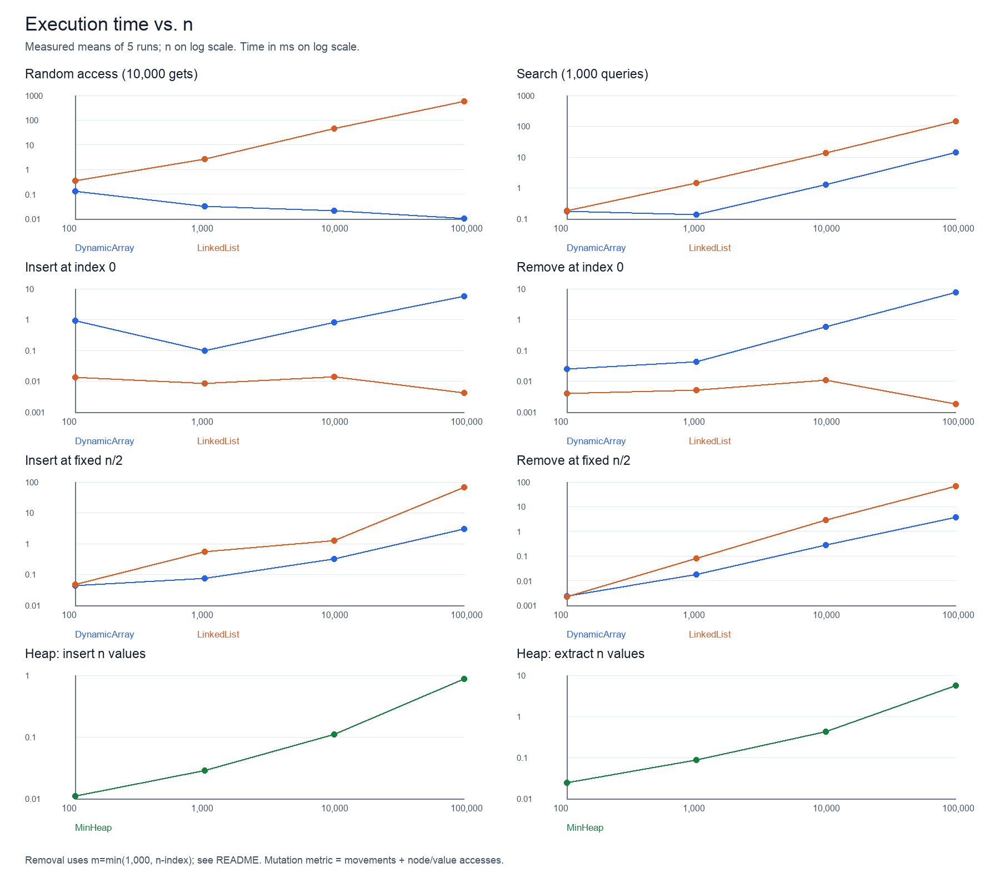
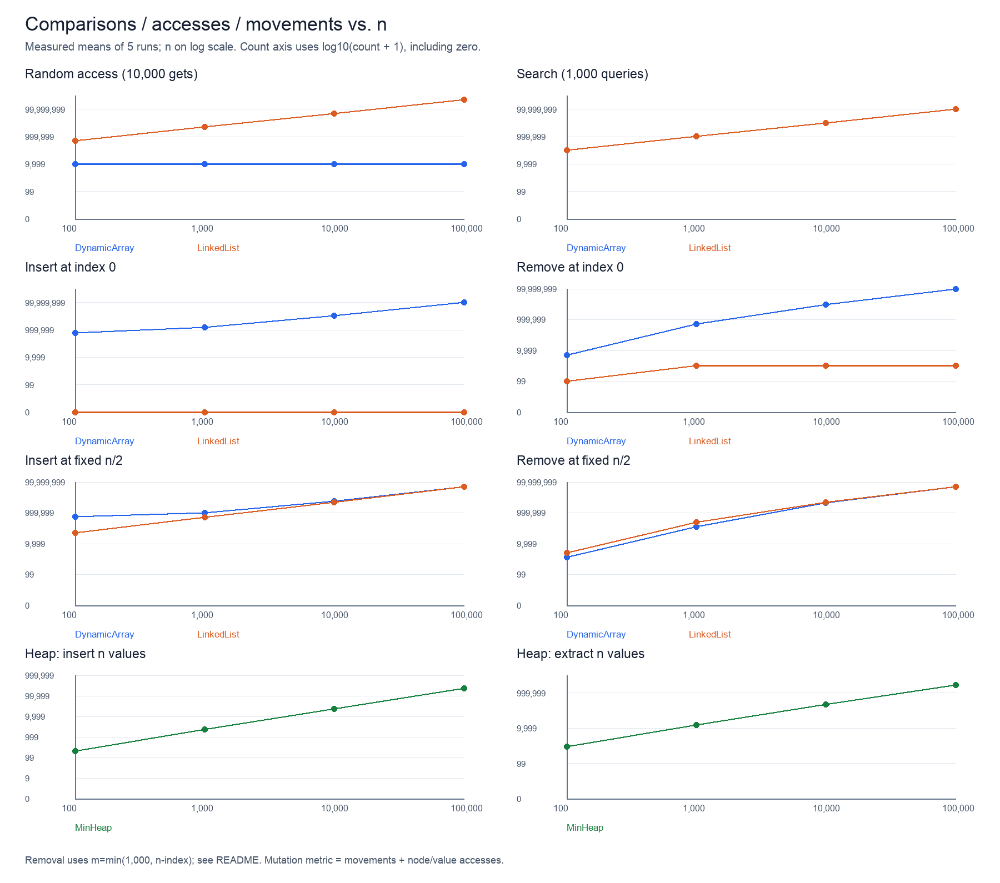

# Assignment 2: data structures and performance

## Overview

This project implements an integer Dynamic Array, a singly Linked List, and a Min-Heap. The array and heap use a manually managed `int[]`. The list uses nodes with a value and a next reference. None of these implementations uses a standard Java collection internally. Standard collections appear only in the tests as reference implementations.

The experiments compare random access, search, and changes at the front and middle of a sequence. The array and list have the same operations, so their results show how storage affects the cost. The heap has a separate workload that repeatedly removes the smallest value.

### Running the project

Use JDK 17 or later. The Java code needs no external dependencies or Maven setup. Run these commands from the project directory:

```sh
mkdir -p build
javac --release 17 -d build src/*.java
java -cp build Tests
java -cp build Benchmark
```

On macOS or Linux, `./run.sh` runs the same steps. These commands also work in a terminal on Windows after creating `build` if needed. To rebuild the graphs and Markdown tables, install Pillow in your Python environment and run:

```sh
python -m pip install Pillow
python scripts/plot_results.py
```

The ZIP includes the measured results and both plots. Running the benchmark again replaces the CSV files. Then run the plotting script to update the graphs and tables. The examples in this report use the included measurements and need updating if you replace them.

```text
assignment-2/
  src/                 implementations, counters, tests, benchmark
  results/tables/      raw.csv, summary.csv, results.md, run logs, environment
  results/plots/       two PNG plots
  scripts/             plot_results.py
  README.md
  COMMIT_PLAN.md
  .gitignore
  run.sh
```

`remove(index)` returns the removed integer. List indices are zero-based. For insertion, `size()` is a valid index; for `get` and `remove`, the last valid index is `size()-1`. Invalid indices throw `IndexOutOfBoundsException`. Empty heap operations throw `NoSuchElementException`. Duplicates and the full integer range are supported.

## Complexity analysis

Here, `n` is the size immediately before a single operation. O is an upper bound, Ω is a lower bound, and Θ gives both bounds. For example, Θ(n) means both O(n) and Ω(n). The best and worst columns describe valid inputs; exception paths take constant time.

For indexed list operations, the average assumes that every valid index is equally likely. Search takes linear average time when the value is missing or its position is uniformly distributed. Array append needs amortized analysis: a full array must grow, while an array with spare capacity can append directly. The amortized bound describes the total cost across a sequence of appends. It does not assume a probability distribution over capacity states.

| Structure and operation | Best (tight) | Average / amortized (tight) | Worst (tight) | Best lower bound | Worst upper bound | Peak auxiliary space |
|---|---|---|---|---|---|---|
| DynamicArray `add(x)` | Θ(1) | Θ(1) amortized | Θ(n) | Ω(1) | O(n) | Θ(1), Θ(n) when growing |
| DynamicArray `add(i,x)` | Θ(1) | Θ(n), uniform i | Θ(n) | Ω(1) | O(n) | Θ(1), Θ(n) when growing |
| DynamicArray `remove(i)` | Θ(1) | Θ(n), uniform i | Θ(n) | Ω(1) | O(n) | Θ(1) |
| DynamicArray `get(i)` | Θ(1) | Θ(1) | Θ(1) | Ω(1) | O(1) | Θ(1) |
| DynamicArray `contains(x)` | Θ(1) | Θ(n) | Θ(n) | Ω(1) | O(n) | Θ(1) |
| LinkedList `add(x)` | Θ(1) | Θ(1) | Θ(1) | Ω(1) | O(1) | Θ(1) |
| LinkedList `add(i,x)` | Θ(1) | Θ(n), uniform i | Θ(n) | Ω(1) | O(n) | Θ(1) |
| LinkedList `remove(i)` | Θ(1) | Θ(n), uniform i | Θ(n) | Ω(1) | O(n) | Θ(1) |
| LinkedList `get(i)` | Θ(1) | Θ(n), uniform i | Θ(n) | Ω(1) | O(n) | Θ(1) |
| LinkedList `contains(x)` | Θ(1) | Θ(n) | Θ(n) | Ω(1) | O(n) | Θ(1) |
| MinHeap `insert(x)` | Θ(1) | Θ(1) expected amortized, random independent keys* | Θ(n), resize; Θ(log n) without resize | Ω(1) | O(n), resize; O(log n) without resize | Θ(1), Θ(n) when growing |
| MinHeap `peekMin()` | Θ(1) | Θ(1) | Θ(1) | Ω(1) | O(1) | Θ(1) |
| MinHeap `extractMin()` | Θ(1) | Θ(log n), random distinct keys | Θ(log n) | Ω(1) | O(log n) | Θ(1) |

*The heap average describes random insertion sequences like the benchmark, including amortized growth. A single insertion into a full backing array still costs Θ(n). If keys arrive in decreasing order, every insertion can climb to the root, giving Θ(log n) amortized per insertion. Without a key distribution, the general amortized insertion upper bound is O(log n), with Ω(1) as a lower bound; there is no universal tight average. The conventional heap insertion bound O(log n) describes the heap adjustment, and a fixed-capacity heap avoids the resizing exception.

### Why these bounds hold

An array `get` calculates one position directly. Search reads values until it finds a match or reaches the end. Inserting at index `i` moves `n-i` elements; removing there moves `n-i-1`. Appending does no shifting, but a full array doubles its capacity and copies `n` values. Across many appends, the copied sizes form a geometric series, so the total copying cost is linear in the number of appends. The array does not shrink on removal.

The singly linked list starts at `head`. Getting index `i` visits `i+1` nodes. Insertion and removal inside the list first find the preceding node, then change a few references. At index zero, neither operation needs a traversal. The stored `tail` makes append and indexed insertion at `size()` constant time. Removing the last element still needs a traversal to find its predecessor.

Heap insertion appends a leaf and moves it up while it is smaller than its parent. The tree height is Θ(log n). It may stop at the first comparison. With independent random keys, long upward paths become less common, which gives constant expected upward work per insertion. The benchmark counts these comparisons directly. `peekMin` reads the root. Extraction puts the last value at the root and moves it down, choosing the smaller child at each level. Usually this takes logarithmic work for random keys. Equal keys can stop it immediately, which explains its constant best case.

All structures occupy Θ(n) stored space under their normal growth from empty. The list has a node and reference overhead per value. Array and heap capacity can remain large after deletions because they do not shrink; more precisely, their storage is Θ(capacity), tied to the largest size reached. Temporary space in the table excludes the structure's existing storage. During resizing the old and new arrays coexist, so peak additional memory is Θ(n). The algorithms are iterative and use no recursion stack.

### Whole-workload cost

In the experiments, `m` counts calls and `n` counts the original elements. Array random access is Θ(m); list random access is Θ(mn) for uniformly random indices. Missing-value search is Θ(mn) for both structures. Array insertion at a fixed index costs Θ(mn + m²), since the suffix grows after each insertion. List front insertion and removal cost Θ(m); list fixed-middle changes cost Θ(mn). Array front and middle removal have Θ(mn) total cost for the valid removal counts used here, though the exact shifting count falls as the structure shrinks.

For priority processing, inserting `n` values has O(n log n) worst-case total cost including O(n) total resizing, with expected Θ(n) total cost for independent random keys. Extracting all values has O(n log n) worst-case total cost and typically Θ(n log n) cost for random distinct keys. The report keeps these separate from the per-operation bounds.

## Correctness

### Proof 1: DynamicArray indexed insertion

Consider `add(k, x)`. Let the original size be `N` and the original values be `A[0..N-1]`, with `0 <= k <= N`. The capacity check gives space for `N+1` values. If it copies the backing array, the copy preserves every original value. The shifting loop starts at `i=N` and runs while `i>k`.

**Loop invariant.** At the start of each iteration, `k <= i <= N`. For every `j` in `[i+1,N]`, `data[j] = A[j-1]`, so the already processed suffix is in its final shifted position. For every `j` in `[0,i-1]`, `data[j] = A[j]`, so the remaining source values are still available. Empty ranges impose no condition.

**Initialization.** Initially `i=N`. The processed suffix `[N+1,N]` is empty and all original positions `[0,N-1]` are unchanged. The invariant holds.

**Maintenance.** When `i>k`, `data[i-1]` still equals `A[i-1]`. Assigning `data[i]=data[i-1]` puts the next suffix value at its final location. Existing shifted positions above `i` are untouched. Decreasing `i` by one extends the processed suffix and leaves the smaller unprocessed prefix unchanged. Thus the invariant holds for the next iteration.

**Termination.** The nonnegative integer `i-k` decreases by one per iteration, so the loop ends at `i=k`. The invariant then gives `data[j]=A[j-1]` for every `j` in `[k+1,N]` and preserves `[0,k-1]`.

**Correctness at termination.** Writing `data[k]=x` fills the only remaining position and increasing the size to `N+1` gives exactly the original prefix, then `x`, then the original suffix. No value is lost. For `k=N`, the loop is empty and the same argument proves append correctness.

### Proof 2: MinHeap minimum extraction

For a nonempty heap, `extractMin()` saves the root, moves the last value to the root, and reduces the size. Deleting the last leaf preserves the complete-tree shape. Every parent-child edge below the root still satisfies heap order. A size of zero or one needs no downward adjustment. For larger heaps, let `i` be the current position of the value being moved downward.

**Loop invariant.** At the start of each iteration, the remaining values form the same multiset as before extraction with one copy of the original root removed. The tree has the required complete shape. Every heap-order edge is valid except possibly the edges from `i` to its children. Each child subtree of `i` is a valid heap. If `i` has a parent, that parent's value is no greater than every value in the subtree rooted at `i`.

**Initialization.** The saved root is a minimum because following any root-to-node path only reaches equal or larger values in a valid heap. Replacing it with the last value removes exactly one original root from the multiset. The child subtrees are unchanged except for deleting the last leaf. Only root-child order can fail. There is no parent at the root, so the final part of the invariant is vacuous.

**Maintenance.** The loop chooses the smaller existing child, called `c`. If `data[i] <= data[c]`, it is also no greater than the other child, so no swap is needed. Otherwise it swaps `i` and `c`. The promoted child is no greater than the other child, the moved value, or its own old descendants. The edges at the old `i` therefore become valid. The edge to the old parent remains valid by the invariant's parent condition. Only the edges below the new `i=c` may now fail. The promoted value is no greater than all values in that new subtree, which preserves the parent condition for the next iteration. A swap preserves shape and the multiset.

**Termination.** Each swap moves down one level in a finite tree. The loop either reaches a leaf (`i >= size/2`) or stops because the current value is no greater than its smaller child. At a leaf there are no suspect outgoing edges. At an early stop both outgoing edges are valid. All other edges are valid by the invariant.

**Correctness at termination.** The remaining tree is a valid min-heap with exactly the original values minus one original root. The returned saved value is the original minimum. Repeating extraction therefore returns a non-decreasing sequence, including when values repeat.

## Experimental setup

All applicable workloads use `n = 100, 1,000, 10,000, 100,000`. Each case has two untimed warm-up runs and five measured runs. Each measured run starts from a fresh structure. The time is the arithmetic mean of five differences from `System.nanoTime()`.

For each `n`, the program creates `new Random(42)` and generates the initial integers, 10,000 indices, 1,000 search values, and 1,000 insertion values before timing. Both sequence structures receive the same arrays, and every repeat reuses them. The generated integers cover the Java `int` range. Search values are independent of the stored values. In this run all queries missed, as shown by exactly `m*n` comparisons.

| Workload | Timed action | m | Measured counter |
|---|---|---:|---|
| Random access | `get` at pre-generated random indices | 10,000 | Array value reads / list node visits |
| Search | `contains` for pre-generated queries | 1,000 | Value equality comparisons |
| Front insertion | `add(0,x)` | 1,000 | Array moves / list node visits |
| Front removal | `remove(0)` from restored original input | See adjustment below | Array moves and removed-value reads / list node visits |
| Middle insertion | `add(n/2,x)` at fixed original index | 1,000 | Array moves / list node visits |
| Middle removal | `remove(n/2)` from restored original input | See adjustment below | Array moves and removed-value reads / list node visits |
| Priority processing | Insert n values into an empty heap, then extract all n | n for each phase | Key comparisons, separately for each phase |

### The removal requirement needs a correction for small inputs

The PDF asks for 1,000 removals from a restored structure of only 100 elements. This cannot be completed as 1,000 valid removals. At a fixed original middle index, even `n=1,000` has only 500 removable values before that index becomes invalid.

This implementation performs `m = min(1,000, n-index)` valid removals and reports the actual `m`. At the front, `m` is 100 for `n=100` and 1,000 for the other sizes. In the middle, it is 50, 500, 1,000, and 1,000. There are no hidden refills or timed exception loops. The middle index stays fixed at the original `n/2`, as stated in the PDF. This is an explicit deviation from the impossible small-input instruction, so the first removal points are not fixed-m comparisons. A different interpretation should be agreed with the instructor if exactly 1,000 successful removals are mandatory.

Initial structure construction, random generation, output, counter reset, and validation are outside the timed section. Resizing and node allocation caused by a timed insertion are included. Heap extraction writes results into a preallocated output array inside timing; checking their order happens afterwards. Each measured priority run verifies heap order after insertion and the extracted sequence after removal. Tests separately verify heap order after every mutation on smaller cases.

After timing, the benchmark writes a checksum to a volatile field to keep the operation results observable. This reduces the risk of dead-code elimination. The benchmark is small and does not use JMH. Cases run in a fixed order in one JVM, without starting a fresh JVM for each case. Two warm-ups may leave some JIT compilation unfinished. Allocation, garbage collection, CPU scheduling, and cache effects can also change the timings. Updating the counters adds overhead, so the times need to be read alongside the logical counts.

### Counter definitions

- `accesses`: an array `get` or removed-value read counts once. A linked-list node visited during indexed traversal counts once; removal also counts the removed node. A list front insertion needs no existing-node visit, so its access counter is zero.
- `comparisons`: one value equality check in `contains`, or one heap key ordering comparison. Bounds checks, loop conditions, and validation checks are excluded.
- `movements`: one copied array element during resizing or shifting. It counts one move per copy, not separate reads and writes. Writing a newly inserted value, clearing a vacated slot, and pointer updates are excluded.

These are logical algorithm counters, not CPU instruction counts. In the mutation plot, movements and accesses are added to show each structure's measured work; the full table keeps them separate. Zero list insertion accesses do not mean zero execution cost. Heap metrics are comparisons only, so resizing copies are included in time but not its comparison count.

### Included run environment

The recorded run used Temurin OpenJDK 25.0.4.1+1-LTS, the OpenJDK 64-Bit Server VM, macOS 26.5, and `aarch64`, with 10 processors reported to Java. Sources were compiled with `--release 17`. The complete timestamp and environment are in [environment.txt](results/tables/environment.txt). The included values were measured on this machine; another machine will give different timings.

## Results

Every table below comes from [summary.csv](results/tables/summary.csv). [raw.csv](results/tables/raw.csv) contains all 280 measured samples: 56 cases with five repeats each. Times below are milliseconds, while the CSV stores nanoseconds. Counters are mean counts per measured run; they are identical across repeats because the inputs and code paths are deterministic.





The time plot uses logarithmic axes. The counter plot uses `log10(count+1)` on the vertical axis to include zero. Search lines overlap because both implementations did exactly the same number of comparisons. These plots show total workload costs, not time per call. For removal, always check the actual m column.

### Random access (10,000 gets)

| Structure | n | Actual m | Mean time (ms) | Accesses | Comparisons | Movements | Workload complexity |
|---|---:|---:|---:|---:|---:|---:|---|
| DynamicArray | 100 | 10000 | 0.129150 | 10,000 | 0 | 0 | Theta(m) |
| LinkedList | 100 | 10000 | 0.344341 | 511,327 | 0 | 0 | Theta(m*n) |
| DynamicArray | 1,000 | 10000 | 0.032475 | 10,000 | 0 | 0 | Theta(m) |
| LinkedList | 1,000 | 10000 | 2.622058 | 5,021,262 | 0 | 0 | Theta(m*n) |
| DynamicArray | 10,000 | 10000 | 0.020884 | 10,000 | 0 | 0 | Theta(m) |
| LinkedList | 10,000 | 10000 | 45.599117 | 50,180,278 | 0 | 0 | Theta(m*n) |
| DynamicArray | 100,000 | 10000 | 0.010283 | 10,000 | 0 | 0 | Theta(m) |
| LinkedList | 100,000 | 10000 | 584.633117 | 505,028,648 | 0 | 0 | Theta(m*n) |

### Search (1,000 queries)

| Structure | n | Actual m | Mean time (ms) | Accesses | Comparisons | Movements | Workload complexity |
|---|---:|---:|---:|---:|---:|---:|---|
| DynamicArray | 100 | 1000 | 0.173183 | 0 | 100,000 | 0 | Theta(m*n) |
| LinkedList | 100 | 1000 | 0.178942 | 0 | 100,000 | 0 | Theta(m*n) |
| DynamicArray | 1,000 | 1000 | 0.135867 | 0 | 1,000,000 | 0 | Theta(m*n) |
| LinkedList | 1,000 | 1000 | 1.432608 | 0 | 1,000,000 | 0 | Theta(m*n) |
| DynamicArray | 10,000 | 1000 | 1.303025 | 0 | 10,000,000 | 0 | Theta(m*n) |
| LinkedList | 10,000 | 1000 | 13.918983 | 0 | 10,000,000 | 0 | Theta(m*n) |
| DynamicArray | 100,000 | 1000 | 14.197917 | 0 | 100,000,000 | 0 | Theta(m*n) |
| LinkedList | 100,000 | 1000 | 142.754059 | 0 | 100,000,000 | 0 | Theta(m*n) |

### Insert at index 0

| Structure | n | Actual m | Mean time (ms) | Accesses | Comparisons | Movements | Workload complexity |
|---|---:|---:|---:|---:|---:|---:|---|
| DynamicArray | 100 | 1000 | 0.928808 | 0 | 0 | 601,420 | Theta(m*n+m^2) |
| LinkedList | 100 | 1000 | 0.013333 | 0 | 0 | 0 | Theta(m) |
| DynamicArray | 1,000 | 1000 | 0.098666 | 0 | 0 | 1,500,524 | Theta(m*n+m^2) |
| LinkedList | 1,000 | 1000 | 0.008600 | 0 | 0 | 0 | Theta(m) |
| DynamicArray | 10,000 | 1000 | 0.811866 | 0 | 0 | 10,499,500 | Theta(m*n+m^2) |
| LinkedList | 10,000 | 1000 | 0.014225 | 0 | 0 | 0 | Theta(m) |
| DynamicArray | 100,000 | 1000 | 5.825825 | 0 | 0 | 100,499,500 | Theta(m*n+m^2) |
| LinkedList | 100,000 | 1000 | 0.004267 | 0 | 0 | 0 | Theta(m) |

### Remove at index 0

| Structure | n | Actual m | Mean time (ms) | Accesses | Comparisons | Movements | Workload complexity |
|---|---:|---:|---:|---:|---:|---:|---|
| DynamicArray | 100 | 100 | 0.025275 | 100 | 0 | 4,950 | Theta(m*n) |
| LinkedList | 100 | 100 | 0.003958 | 100 | 0 | 0 | Theta(m) |
| DynamicArray | 1,000 | 1000 | 0.042400 | 1,000 | 0 | 499,500 | Theta(m*n) |
| LinkedList | 1,000 | 1000 | 0.005209 | 1,000 | 0 | 0 | Theta(m) |
| DynamicArray | 10,000 | 1000 | 0.571450 | 1,000 | 0 | 9,499,500 | Theta(m*n) |
| LinkedList | 10,000 | 1000 | 0.010992 | 1,000 | 0 | 0 | Theta(m) |
| DynamicArray | 100,000 | 1000 | 7.520308 | 1,000 | 0 | 99,499,500 | Theta(m*n) |
| LinkedList | 100,000 | 1000 | 0.001817 | 1,000 | 0 | 0 | Theta(m) |

### Insert at fixed n/2

| Structure | n | Actual m | Mean time (ms) | Accesses | Comparisons | Movements | Workload complexity |
|---|---:|---:|---:|---:|---:|---:|---|
| DynamicArray | 100 | 1000 | 0.044141 | 0 | 0 | 551,420 | Theta(m*n+m^2) |
| LinkedList | 100 | 1000 | 0.047633 | 50,000 | 0 | 0 | Theta(m*n) |
| DynamicArray | 1,000 | 1000 | 0.073867 | 0 | 0 | 1,000,524 | Theta(m*n+m^2) |
| LinkedList | 1,000 | 1000 | 0.542358 | 500,000 | 0 | 0 | Theta(m*n) |
| DynamicArray | 10,000 | 1000 | 0.322225 | 0 | 0 | 5,499,500 | Theta(m*n+m^2) |
| LinkedList | 10,000 | 1000 | 1.263808 | 5,000,000 | 0 | 0 | Theta(m*n) |
| DynamicArray | 100,000 | 1000 | 2.941233 | 0 | 0 | 50,499,500 | Theta(m*n+m^2) |
| LinkedList | 100,000 | 1000 | 67.214792 | 50,000,000 | 0 | 0 | Theta(m*n) |

### Remove at fixed n/2

| Structure | n | Actual m | Mean time (ms) | Accesses | Comparisons | Movements | Workload complexity |
|---|---:|---:|---:|---:|---:|---:|---|
| DynamicArray | 100 | 50 | 0.002325 | 50 | 0 | 1,225 | Theta(m*n) |
| LinkedList | 100 | 50 | 0.002267 | 2,550 | 0 | 0 | Theta(m*n) |
| DynamicArray | 1,000 | 500 | 0.017650 | 500 | 0 | 124,750 | Theta(m*n) |
| LinkedList | 1,000 | 500 | 0.078675 | 250,500 | 0 | 0 | Theta(m*n) |
| DynamicArray | 10,000 | 1000 | 0.281742 | 1,000 | 0 | 4,499,500 | Theta(m*n) |
| LinkedList | 10,000 | 1000 | 2.829350 | 5,001,000 | 0 | 0 | Theta(m*n) |
| DynamicArray | 100,000 | 1000 | 3.747300 | 1,000 | 0 | 49,499,500 | Theta(m*n) |
| LinkedList | 100,000 | 1000 | 67.310475 | 50,001,000 | 0 | 0 | Theta(m*n) |

### Heap: insert n values

| Structure | n | Actual m | Mean time (ms) | Accesses | Comparisons | Movements | Workload complexity |
|---|---:|---:|---:|---:|---:|---:|---|
| MinHeap | 100 | 100 | 0.011059 | 0 | 206 | 0 | O(n*log(n)); expected Theta(n) random keys |
| MinHeap | 1,000 | 1000 | 0.028283 | 0 | 2,326 | 0 | O(n*log(n)); expected Theta(n) random keys |
| MinHeap | 10,000 | 10000 | 0.110467 | 0 | 22,753 | 0 | O(n*log(n)); expected Theta(n) random keys |
| MinHeap | 100,000 | 100000 | 0.875700 | 0 | 227,857 | 0 | O(n*log(n)); expected Theta(n) random keys |

### Heap: extract n values

| Structure | n | Actual m | Mean time (ms) | Accesses | Comparisons | Movements | Workload complexity |
|---|---:|---:|---:|---:|---:|---:|---|
| MinHeap | 100 | 100 | 0.024350 | 0 | 863 | 0 | O(n*log(n)); typical Theta(n*log(n)) |
| MinHeap | 1,000 | 1000 | 0.086508 | 0 | 14,996 | 0 | O(n*log(n)); typical Theta(n*log(n)) |
| MinHeap | 10,000 | 10000 | 0.422267 | 0 | 216,531 | 0 | O(n*log(n)); typical Theta(n*log(n)) |
| MinHeap | 100,000 | 100000 | 5.601975 | 0 | 2,831,426 | 0 | O(n*log(n)); typical Theta(n*log(n)) |


## Discussion

### 1. How does increasing n affect each workload?

The list's random-access time rises from 0.344 ms at `n=100` to 584.633 ms at `n=100,000`. Its node visits rise from 511,327 to 505,028,648. The array performs 10,000 accesses at every size, but its measured time falls. The JVM and measurement limits discussed below help explain that drop; the constant access count does not predict it.

Search comparisons increase by ten times for every tenfold increase in n: 100,000, 1,000,000, 10,000,000, and 100,000,000 for both structures. At the largest size the array takes 14.198 ms and the list 142.754 ms. At the two largest sizes the time growth is roughly linear.

Front insertion and removal leave list traversal work almost unchanged when m is fixed. Array shifting grows with n. At `n=100,000`, front insertion takes 5.826 ms for the array and 0.004267 ms for the list; front removal takes 7.520 ms and 0.001817 ms. The list's smaller times should be treated cautiously because these short workloads are sensitive to compilation and measurement overhead.

Middle changes become more expensive in both structures. At `n=100,000`, insertion takes 2.941 ms for the array and 67.215 ms for the list. Removal takes 3.747 ms and 67.310 ms. The array copies a suffix; the list repeatedly walks about half the original list. Small-input removal also has a smaller m, so its early points mix input growth with operation-count growth.

Priority insertion comparisons rise from 206 to 227,857. Extraction comparisons rise from 863 to 2,831,426. At `n=100,000`, insertion takes 0.876 ms and extraction takes 5.602 ms. Extraction has more comparisons and more tree levels to visit.

### 2. Which results agree with theoretical complexity?

The work counters follow the expected costs closely. Array random access stays at m accesses, while list random access visits roughly m(n+1)/2 nodes. Search uses exactly mn comparisons because every query misses. Front removal visits one removed node per call in the list. The array also has to shift the remaining suffix.

For example, at `n=100,000`, the 1,000 array front insertions move 100,499,500 values. This equals `m*n + m*(m-1)/2`; no resize is needed during that case. Front removal moves 99,499,500 values, equal to `m*(n-1) - m*(m-1)/2`. Middle list insertion visits 50,000,000 nodes, equal to `m*(n/2)`. These counts directly match the loops.

Heap insertion uses about 2.28 comparisons per value at the largest two sizes, consistent with constant expected upward work for random input. Extraction uses about 21.65 comparisons per value at `n=10,000` and 28.31 at `n=100,000`, consistent with a growing logarithmic path. These observations support the analysis for these inputs; they do not prove worst-case bounds.

### 3. Where do the results differ from the theoretical prediction?

The array random-access time falls from 0.129150 ms at `n=100` to 0.010283 ms at `n=100,000`, even though its access count stays constant. Search at `n=1,000` is also faster than search at `n=100` for the array despite ten times as many comparisons. Array front insertion at `n=100` is slower than at `n=1,000` despite fewer moves.

Later cases may benefit from code compiled during earlier cases. Two warm-up rounds may be too few, and the smallest workloads finish so quickly that measurement noise matters. The logs keep these irregular results. They do not show that larger inputs make the algorithms inherently faster. JIT compilation could explain the drop, although this run does not separate its effect from scheduling and other noise.

The early removal points also differ from a fixed-m prediction because the PDF's small-input cases cannot support 1,000 valid removals. Their actual m is visible in every table.

### 4. Why can algorithms with the same Big-O have different running times?

Both searches are Θ(n) per missing query and perform 100,000,000 comparisons at the largest size. The array is about ten times faster in this run. It stores integers together in one buffer. The list stores them in separate objects and follows a reference at every step. Big-O does not describe those costs. Middle changes show the same effect: both structures do linear work per call, but copying the array's suffix is faster here than walking the list.

### 5. How do constant factors and implementation details affect performance?

The list's tail pointer makes append constant time, but it does not help access by index. Using a singly linked list means every middle operation begins at the head. The array doubles capacity, so it occasionally copies all stored values. At `n=100`, insertion movement counts include several such resizes; at the largest size the existing spare capacity is enough for all 1,000 insertions.

Manual copy loops may be optimized by the JVM. Node creation, memory locality, and garbage collection can also affect time. Each implementation updates counters during the measured work, which adds its own cost. These factors help explain timing differences, but this benchmark does not measure CPU cache misses, allocation rates, or GC pauses separately.

### 6. Why is a Dynamic Array preferable for some workloads?

It provides direct indexed access, with 10,000 accesses at every n in this experiment. At `n=100,000`, its random-access workload takes about 0.010 ms while the list takes about 585 ms. It is also a good choice for scans: the search comparison counts are identical, but its measured search time is much lower at the larger sizes. Appending is amortized constant time. Frequent front changes are more expensive because they shift nearly the whole array.

### 7. When can a Linked List be useful?

The list works well for frequent changes at the front. Each change updates only a few references, and the largest-size front insertion and removal are much faster than the array's in this run. The tail pointer also makes append cheap. Middle changes can be cheap if the relevant node is already known. This project's API takes indices, so it must walk to that node first. Its middle insertions therefore take linear time.

### 8. Why is a Heap appropriate for priority-based processing?

The root always holds a minimum, so `peekMin` is constant time. Insertion and extraction restore order along a single tree path instead of sorting all stored values after every change. The benchmark verifies that all extracted values are non-decreasing. At `n=100,000`, it inserts and then extracts all values in about 6.478 ms combined. This measured cost and the logarithmic worst-case heap adjustment make a heap suitable for a stream of changing priorities. There is no timed comparison against a sorted list here, so the results do not establish a speed ranking against every possible alternative.

### 9. How does the workload influence the choice of structure?

For many random reads, choose the array. For front changes, this list avoids shifts and performs well. For middle changes by index, the array is faster in the large cases even though both structures do linear work. For repeated minimum extraction, use the heap. The operation mix matters: a list that saves time on front insertion can lose much more time if every insertion is followed by many indexed reads.

## Design recommendations

| Need | Choice | Reason from analysis and this run |
|---|---|---|
| Many indexed reads | DynamicArray | Θ(1) get; fixed access count and much faster measured access |
| Repeated scans or contains | DynamicArray among these two sequence structures | Both are linear, but the array scans faster at large n |
| Frequent front insertion/removal | LinkedList | Θ(1) work per call, without shifting the remaining values |
| Mostly append and indexed reads | DynamicArray | Amortized Θ(1) append and Θ(1) get |
| Many middle changes using an index | DynamicArray for the tested cases | Both are linear; contiguous shifting was faster than list traversal |
| Repeatedly read or remove the smallest value | MinHeap | Θ(1) peek and O(log n) heap adjustment, with ordered extraction verified |

For frequent membership checks, a hash-based structure is another option to consider. It is outside this assignment and was not benchmarked. A list API that accepts existing node references would also change the cost of middle operations. These measurements apply to operations that take an index.

## Conclusion

The work counts explain most of the large-input results. Array indexed access stays constant, list indexed access grows with n, and both searches do linear work. The list performs front changes without shifting values. For indexed middle changes, its traversal cost makes it slower than the array in the larger tested cases. The heap returns values in order with growing but manageable extraction work.

The JVM affects the small timings, so they cannot give an exact scaling rule. The CSV files keep every measured sample. For small removal cases, the tables report the actual operation count and the setup section explains the adjustment.

### Testing and submission notes

`Tests.java` checks empty structures, a single element, multiple values, duplicates, minimum and maximum integers, insertion at both boundaries, invalid indices, reuse after emptying, and 100,000-element inputs. Random sequences compare the custom array with `java.util.ArrayList`, the custom list with `java.util.LinkedList`, and the heap with `java.util.PriorityQueue`. On the smaller heap cases, the property is checked after every insertion and extraction. Ordered full extraction and large-input reference comparisons are also checked. Small counter checks verify representative access, comparison, and movement counts.

The included test run passed 5,327,957 checks. See [tests.txt](results/tables/tests.txt). Compilation with `javac --release 17 -Xlint:all` produced no warnings. The benchmark completed all four input sizes; see [benchmark-run.txt](results/tables/benchmark-run.txt).

The PDF asks for a GitHub repository link and meaningful development commits. The package has not been published to GitHub and has no fabricated Git history. [COMMIT_PLAN.md](COMMIT_PLAN.md) lists files to review and commit in stages. This README is the individual report. [REQUIREMENTS_CHECK.md](REQUIREMENTS_CHECK.md) maps the PDF requirements to the files and records the removal adjustment. Review the code and measurements before submitting, and confirm the removal interpretation with the instructor.
